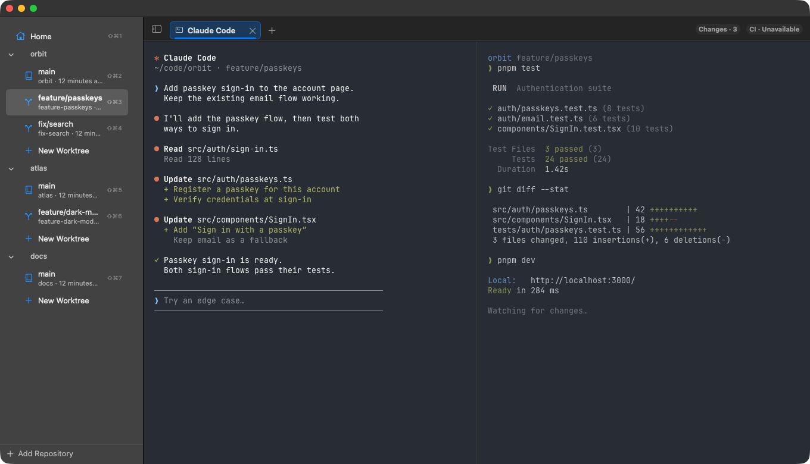

# Workbench

A native macOS terminal workspace for working across Git repositories, worktrees, and coding agents. Powered by [Ghostty](https://github.com/ghostty-org/ghostty).


*Demo data only. No personal repositories, accounts, or terminal history.*

- **A workspace per worktree.** Each branch keeps its own tabs and splits; terminals keep running when you switch away.
- **Claude Code and Codex status.** See which agents are working, finished, or waiting for you, and resume eligible sessions after relaunch.
- **Changes and CI at hand.** Review diffs, pull requests, and checks beside your terminals.
- **Take your terminals with you.** Attach to the same sessions from the iPhone app or another Mac over Tailscale.

## Build and run

Requires macOS 14+, a Swift toolchain, and Xcode. Building libghostty also requires the Zig version specified by its `build.zig.zon`. The default build targets your Mac’s architecture.

```sh
git clone https://github.com/jfd02/workbench.git
cd workbench
./scripts/build-ghostty.sh   # first build; requires Zig
./scripts/bundle.sh
open build/Workbench.app
```

Add a repository in the sidebar, select a worktree, and open a terminal. Workbench reads your Ghostty configuration for fonts, themes, and keybindings.

## Shortcuts

| Shortcut | Action |
| --- | --- |
| `⌘T` / `⌘W` | Open / close a tab or focused pane |
| `⌘D` / `⌘⇧D` | Split right / down |
| `⌘1`…`⌘9` | Switch tabs |
| `⌘⇧1`…`⌘⇧9` | Switch workspaces |
| `⌘⇧G` / `⌘⇧I` | Show changes / CI checks |
| `⌃⌘S` | Toggle the sidebar |

## More

- [iPhone setup](docs/guide.md#on-your-iphone) · [Remote CLI](docs/guide.md#from-another-mac)
- [User hooks](docs/guide.md#user-hooks) · [Agent status and resume](docs/guide.md#agent-status)
- [Development and testing](docs/guide.md#testing) · [Packaging](docs/guide.md#sharing-it-with-another-mac) · [Known limitations](docs/guide.md#known-gaps)

Quitting ends running shells; saved layouts restore on launch. Formerly TabTerm, Workbench retains its original data paths and configuration names for compatibility.

Includes MIT-licensed Ghostty components; see [GHOSTTY-LICENSE](Frameworks/GHOSTTY-LICENSE).
